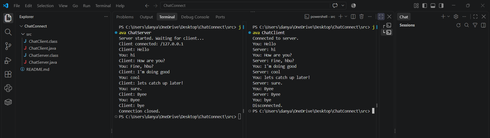

# ChatConnect

LAN Chat Application using Java TCP Socket Programming.

## Description
A basic client-server chat application where a client connects to a server and both exchange messages over a TCP connection.

## Computer Networks Concept Used
- Protocol: TCP
- Client-server communication using sockets
- Java classes: `Socket`, `ServerSocket`, `BufferedReader`, `PrintWriter`

```
Client
   │
   │ TCP Connection
   ▼
Server
   │
   │ Socket Communication
   ▼
Messages exchanged
```

## Project Structure
```
ChatConnect/
├── src/
│   ├── ChatServer.java
│   └── ChatClient.java
├── screenshots/
│   └── output.png
└── README.md
```

## How to Run
1. Open a terminal in the `src` folder and compile:
```
   javac ChatServer.java ChatClient.java
```
2. Start the server (Terminal 1):
```
   java ChatServer
```
3. Start the client (Terminal 2):
```
   java ChatClient
```
   To connect from another PC on the same LAN: `java ChatClient <server-ip>`
4. Type messages in turn. Type `bye` from the client to end the chat.

## Sample Output


**Server:**
```
Server started. Waiting for client...
Client connected: /127.0.0.1
Client: Hello
You: hi
Client: How are you?
You: Fine, hbu?
Client: bye
Connection closed.
```

**Client:**
```
Connected to server.
You: Hello
Server: hi
You: How are you?
Server: Fine, hbu?
You: bye
Disconnected.
```